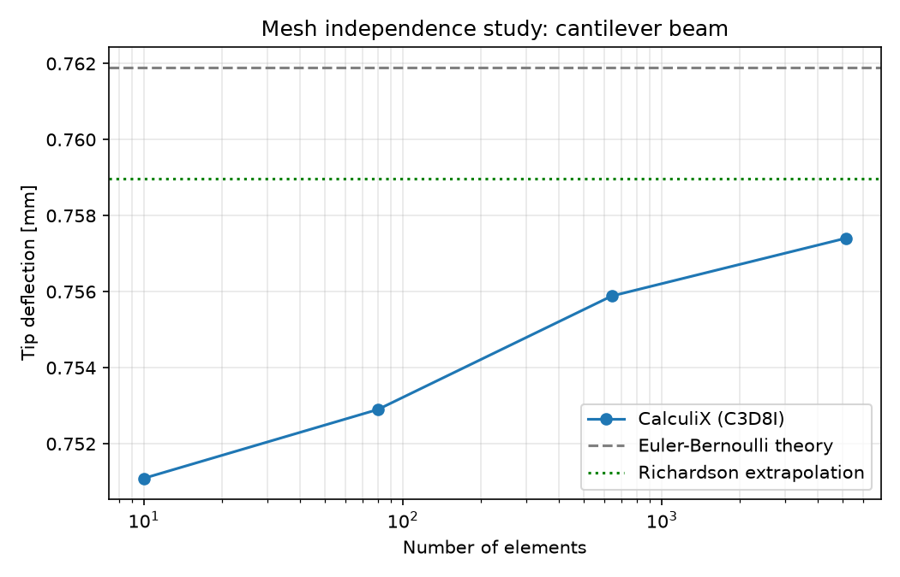
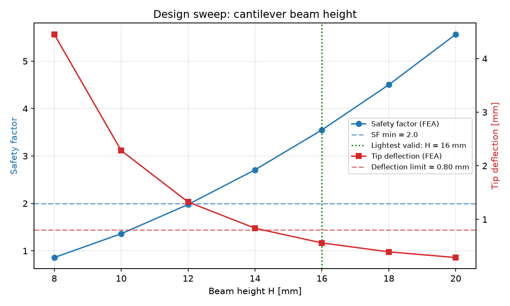

# Scripted FEA of a cantilever beam: Gmsh + CalculiX + Python

A fully scripted structural analysis workflow built with open-source tools. No GUI is used at any step: the geometry and mesh are generated with the Gmsh Python API, the CalculiX input deck is written by Python, the solver runs from the command line, and the results are read, verified against beam theory and post-processed automatically.

**Author:** Enzo Zanatta, Mechanical Engineer (FEI, Brazil)

## Workflow

1. **Geometry and mesh** (`gmsh` Python API): structured hexahedral mesh built by extrusion.
2. **Input deck** (Python): nodes, C3D8I elements (8-node hexahedra with incompatible modes, accurate in bending), node sets, material, boundary conditions and loads.
3. **Solver** (CalculiX `ccx`): linear static analysis, run from the command line with `subprocess`.
4. **Post-processing** (Python): tip deflection and bending stress read from the `.dat` file.
5. **Verification**: comparison with Euler-Bernoulli beam theory and a mesh convergence study with the Grid Convergence Index (GCI).
6. **Design optimization**: automated sweep of the beam height to find the lightest design that meets a safety factor and a deflection limit.

## Scripts

| Script | What it does |
|---|---|
| `beam_v1.py` | Builds the mesh, writes the input deck, runs CalculiX and compares the tip deflection with beam theory |
| `beam_v2_mesh_study.py` | Mesh independence study on four meshes (refinement ratio 2), with Richardson extrapolation and GCI |
| `beam_v3_optimization.py` | Height sweep with stress and deflection checks, and selection of the lightest valid design |

## Results

### 1. Verification against beam theory

Steel beam, L = 200 mm, b = 20 mm, h = 10 mm, P = 100 N at the tip.

| | Tip deflection |
|---|---|
| CalculiX (640 C3D8I elements) | 0.7559 mm |
| Euler-Bernoulli theory, δ = PL³/3EI | 0.7619 mm |
| Difference | -0.79 % |

### 2. Mesh independence study

| Mesh | Elements | Tip deflection [mm] | Change vs previous |
|---|---|---|---|
| 10x1x1 | 10 | 0.75109 | |
| 20x2x2 | 80 | 0.75290 | +0.241 % |
| 40x4x4 | 640 | 0.75588 | +0.397 % |
| 80x8x8 | 5120 | 0.75740 | +0.201 % |

- GCI on the fine mesh: **0.26 %**, so the solution is mesh independent.
- The remaining ~0.4 % difference to Euler-Bernoulli is a **modeling difference, not a discretization error**: the fully clamped 3D root restrains the Poisson contraction, and beam theory neglects shear deformation.



### 3. Design optimization

**Problem:** find the lightest beam height H for P = 300 N, with a safety factor ≥ 2 on yield (250 MPa) and a tip deflection ≤ L/250 = 0.8 mm.

| H [mm] | Mass [kg] | Stress FEA [MPa] | Stress theory [MPa] | SF | Deflection FEA [mm] | Deflection theory [mm] | Valid |
|---|---|---|---|---|---|---|---|
| 12 | 0.377 | 126.4 | 125.0 | 1.98 | 1.324 | 1.323 | no |
| 14 | 0.440 | 92.3 | 91.8 | 2.71 | 0.835 | 0.833 | no |
| **16** | **0.502** | **70.4** | **70.3** | **3.55** | **0.560** | **0.558** | **yes** |
| 18 | 0.565 | 55.5 | 55.6 | 4.50 | 0.394 | 0.392 | yes |

**Lightest valid design: H = 16 mm (0.502 kg).** The design is driven by **stiffness, not strength**: at 12 mm the safety factor is almost met, but the deflection is too large.



## Engineering notes

- **Boundary condition at the root:** for the optimization, the clamp fixes the axial displacement on the whole root face and only one line in each transverse direction. This lets the section contract laterally, matching the beam-theory clamp and removing the artificial stress concentration of a fully fixed face. The deflection then matches theory within 0.4 %.
- **Stress at the surface:** CalculiX reports stresses at the Gauss integration points, which lie inside the elements. Since bending stress varies linearly through the height, the outermost Gauss-point value is extrapolated to the surface. Without this correction, the maximum stress would be underestimated by about 5 %, which is non-conservative.
- **Element choice:** C3D8I elements avoid the shear locking of fully integrated linear hexahedra in bending, so even coarse meshes give accurate deflections.

## How to run

Requirements: Python 3, the packages in `requirements.txt`, and the CalculiX solver (`ccx`). On Windows, `ccx` is included in the [PrePoMax](https://prepomax.fs.um.si) download.

```
pip install -r requirements.txt
```

Set the path to the CalculiX executable in `beam_v1.py` (`CCX = ...`), then run:

```
python beam_v1.py
python beam_v2_mesh_study.py
python beam_v3_optimization.py
```
